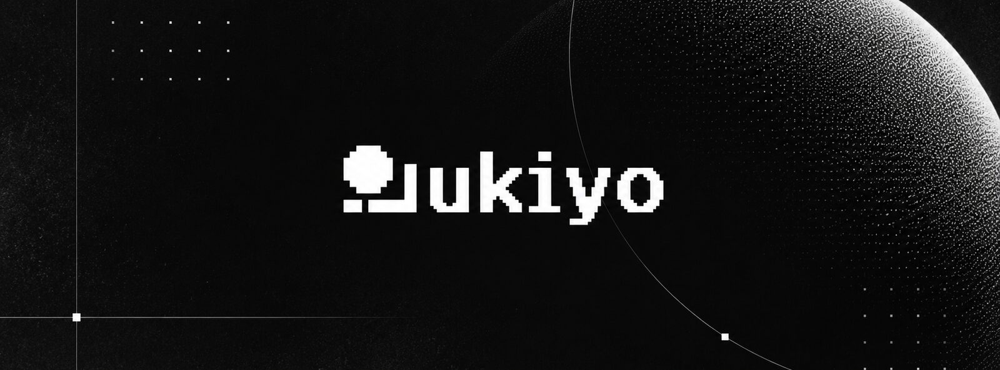
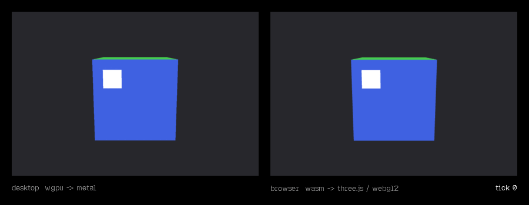
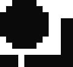

<div align="center">

<picture>
  <source media="(prefers-color-scheme: dark)" srcset=".github/assets/banner-dark.jpg">
  <source media="(prefers-color-scheme: light)" srcset=".github/assets/banner-light.jpg">
  
</picture>

<h3>The world is code. Agents build it. You watch every tick.</h3>

An agent-native game engine in C#. Your coding agent reads and changes the game's code while it runs,<br>
through skills and MCP. The Studio is the human window: watch, edit, take over.<br>
Assemble it like Arch Linux: simple, balanced or complete.

<br>

[](docs/G0.md)
[](https://dotnet.microsoft.com/)
[](#how-it-works)
[](#quickstart)
[](LICENSE)

[Website](https://ukiyoengine.top) · [Quickstart](#quickstart) · [Studio](#studio) · [How it works](#how-it-works) · [Roadmap](#roadmap) · [Docs](#docs)

</div>

<br>

<div align="center">
  
  <br>
  <sub>Same <code>Program.cs</code>. Left: native window, wgpu → Metal. Right: browser, .NET WebAssembly → three.js.<br>Every frame was read back from each renderer at the same tick. Nothing here is a mockup.</sub>
</div>

<br>

## Why ukiyo

Game engines were built around a person holding a mouse. The editor owns the truth, code gets attached to it, and
anything automated has to poke at it from the outside.

ukiyo starts from the other end.

- **The code is the world.** Scenes, entities, transforms and components are plain C#. There is no hidden editor state to reverse-engineer: what a person or an agent writes is exactly what runs.
- **Agents are native, not bolted on.** Fixed 60 Hz ticks, headless runs, structured snapshots, typed errors and build-stamped evidence are engine features. Tool protocols sit on top as thin adapters; they are not the product.
- **Your agent gets a whole engine, live.** It connects through skills and MCP and works on the game while it runs: pause, step, capture the real GPU frame, inject input, patch the scene, rewind. Every system comes with a skill that teaches it and checks that prove the result, on code and on real frames.
- **Humans stay in the loop.** The Studio shows the running game, lets you inspect and edit it, run and reload it, and take over at any point, without ever becoming the source of truth.
- **Take only what you need.** Like Arch Linux: simple, balanced or complete, for the Studio's layout and for the skills your agent loads. The Studio's panels, layouts and themes are plain files you can rewrite.
- **One program, every target.** Renderers implement one contract. The same `Program.cs` runs on wgpu/Metal, in the browser through WebAssembly, on the CPU and with no GPU at all.
- **Games ship alone.** A desktop export is a single native executable. A web export is a folder of static files. No editor, daemon or model at runtime.

## Status

Pre-alpha. Gates close only with evidence, and each report says what ran, what passed and what is still open.

| Gate | State | Evidence |
|---|---|---|
| **G0** · one program, two real renderers | closed, released as 0.0.1 | [G0 report](docs/G0.md) |
| **G1** · runtime slice | every check passes, on `main`, not released | [G1 report](docs/G1.md) |
| **G2** · authoring and data | most of it in the tree, no report yet | [scenes and patches](docs/scenes-patches.md) · [assets](docs/assets.md) |
| **G3** · Studio and reload | base runs against a live game; Run and reload implemented | [G3 report](docs/G3.md) |

What 0.0.1 proves, reproducible with `scripts/g0.sh`:

- **One source, three targets.** Every host prints the SHA-256 of the shared game files; they match on desktop, web, headless and both AOT builds.
- **Real renderers.** wgpu-native on Metal (Apple M4 Pro) and three.js on WebGL2, plus a null renderer that never touches a GPU.
- **Identical simulation.** Rotation at ticks 0, 60, 180 and 600 is bit-for-bit equal across all targets.
- **Nothing moves behind your back.** Paused in the browser, 1.5 s of real time advance zero ticks and consecutive frames are pixel-identical.
- **Single binary.** `rotating-cube` is one 10.3 MB NativeAOT executable with wgpu and SDL linked in. It runs copied alone into an empty folder.
- **Static web.** The published site runs from any static file server, in IL or WebAssembly-AOT form.

Since then, G1 added the runtime slice: LanternRun, a small platformer, runs headless, on Metal and in the browser with
the same simulation and the same pixels.

## What is in the tree

Everything below builds with warnings as errors and passes its C# and JS tests in CI.

| Area | What you get |
|---|---|
| **2D** | Textures (PNG decoder), sprites in world and screen space, sprite sheets and animations |
| **Rendering** | wgpu/Metal, three.js/WebGL2, a CPU renderer that captures frames headless, and a null renderer. Profile `G1Lit`: per-pixel Lambert with directional and point lights ([lighting](docs/rendering-lighting.md)); up to four camera passes per frame for minimaps and split screen ([passes](docs/rendering-passes.md)) |
| **Input** | Keyboard and pointer latched per tick, deterministic input scripts, recording and replay ([input contract](docs/decisions/input-contract.md)) |
| **Physics** | `Ukiyo.Physics`: deterministic 2D rigid bodies with sensors, raycasts and layers |
| **Animation** | `Ukiyo.Animation`: follow, orbit, rail and fixed cameras, a camera director, camera shake, tweens, easing and tick-based sequences |
| **Particles** | `Ukiyo.Particles`: deterministic particles and effects with budgets |
| **NPCs** | `Ukiyo.AI`: state machines, behavior trees, deterministic grid A* and steering, readable in snapshots |
| **Game UI** | `Ukiyo.UI`: immediate-mode HUDs and menus, pixel font, keyboard and pointer focus |
| **Audio** | `Ukiyo.Audio`: sounds as events from `Update`, a shared mixer, WAV assets and a seeded synthesizer. SDL3 on desktop, Web Audio in the browser, WAV recording headless |
| **Scenes** | Scenes as data, prefabs as functions, validated patches applied between ticks, a bounded patch history in snapshots ([scenes and patches](docs/scenes-patches.md)) |
| **Save and replay** | `ISaveable` games save at any tick, load in a new process, replay from checkpoints and rewind live ([save and replay](docs/save-replay.md)) |
| **Assets** | PNG sprites, atlases and glTF meshes compile into `Shared/gen/*.g.cs` through `tools/Ukiyo.Import` ([assets](docs/assets.md)) |
| **Dev bridge** | A running desktop build answers on localhost: status, pause, step, snapshot, capture, input, record, patch, history, rewind |
| **Exports** | NativeAOT single binaries with no dev bridge, and static web folders ([export](docs/export.md)) |

### For agents

`tools/mcp` is an MCP server (Bun, no dependencies). The same tools run as a CLI: `bun tools/mcp/src/cli.ts --help`.

| Tool | What it does |
|---|---|
| `ukiyo_status` | Games in the repo, their render profile, scenes and stale assets |
| `ukiyo_run` | Headless run with snapshots at chosen ticks, input scripts, patch logs, save and load |
| `ukiyo_capture` | Real frames from the CPU renderer, one camera pass or the composed frame |
| `ukiyo_test` | The C# and JS test suites |
| `ukiyo_check` | Whether a game follows the [layout contract](docs/game-layout.md) |
| `ukiyo_live` | A running game: pause, step, snapshot, GPU capture, input, record, patch, rewind, reload |
| `ukiyo_new_game` | Scaffold a game from `templates/game` |
| `ukiyo_import` | Check or regenerate imported assets |
| `ukiyo_sprite_*` | Generate pixel-art sprites (OpenAI or Gemini image models, or offline), process them, build sheets |
| `ukiyo_sound_generate` | Sound effects from a synth preset and a seed, no audio files |
| `ukiyo_studio` | What the person is looking at, notices to them, and changes to the Studio's composition |
| `ukiyo_skills` | List or install skills |

`skills/` holds 21 skills, one per area, with four presets in `skills/presets.json`: **simple**, **balanced** and
**complete** for making games, **engine** for working on ukiyo itself. In this repository they are linked into
`.claude/skills` and `.agents/skills`.

### Samples

| Sample | Shows |
|---|---|
| `RotatingCube` | The template: the smallest complete game |
| `LanternRun` | A platformer with sprites, input, physics, UI and audio |
| `TexturedQuad` | An imported PNG texture |
| `ImportedMesh` | An imported glTF mesh |
| `LitCube` | The `G1Lit` profile with lights |
| `Minimap` | Two camera passes in one frame |
| `SceneHop` | Scenes, prefabs and patches |
| `Sparks` | Particles |
| `CameraRig` | Gameplay cameras, tweens and sequences |
| `Patrol` | NPCs with state machines, behavior trees and grid navigation |

## Quickstart

Apple Silicon Mac with the .NET 10 SDK (`10.0.401`), Xcode command line tools, cmake, ninja and [bun](https://bun.sh).

```sh
git clone https://github.com/Obed0101/ukiyo && cd ukiyo
scripts/fetch-native.sh                  # pinned wgpu-native + SDL3, static and shared
(cd web/three-adapter && bun install)    # pinned three.js
```

Run the same game three ways:

```sh
dotnet run --project samples/RotatingCube/Hosts/Headless   # no window, no GPU
dotnet run --project samples/RotatingCube/Hosts/Desktop    # native window, wgpu → Metal  (F5: pause · F6: step)

dotnet publish samples/RotatingCube/Hosts/Browser -c Release -o artifacts/web
python3 -m http.server --directory artifacts/web/wwwroot 8080   # open http://localhost:8080
```

Ship it:

```sh
dotnet publish samples/RotatingCube/Hosts/Export.Desktop -c Release -o artifacts/desktop
./artifacts/desktop/rotating-cube        # one file: no .NET, no dylibs, no editor
```

Verify:

```sh
scripts/g0.sh                            # G0 end to end (opens a window for a few seconds)
scripts/g1.sh                            # G1: headless, Metal and WebGL2 parity
scripts/clean-run.sh RotatingCube        # an export runs alone, with no .NET or dylibs (docs/export.md)
```

Drive a game from the terminal, the way an agent does:

```sh
bun tools/mcp/src/cli.ts status
bun tools/mcp/src/cli.ts run LanternRun --checkpoints 0,60,600
bun tools/mcp/src/cli.ts live list       # development builds that are running
```

## Studio

`studio/` (Bun, plain ES modules, no dependencies) is the person's window onto a running game. It never owns game
state: it looks at the game through the dev bridge, and the game stays code.

```sh
bun studio/src/server.ts                 # → http://127.0.0.1:4100
```

- **Hub.** The start screen lists the games and samples in the repository and creates new ones.
- **Editor.** Hierarchy, the real frame and Inspector side by side, with Console and Assets as tabs below. The header
  runs, pauses, steps and reloads the game. Run starts the desktop host; reload rebuilds and relaunches it at the same
  tick and checks that the snapshot matches ([G3](docs/G3.md)).
- **Settings.** Theme (`contrast`, `graphite`, `ink`, `linen`, `paper`), layout (`editor`, `simple`, `focus`,
  `balanced`, `wide`, `complete`) and which panels are shown.
- **The UI is files.** Panels are `studio/panels/*.js`, layouts and themes are JSON. Your own copies live in
  `~/.config/ukiyo/studio` (or `UKIYO_STUDIO_CONFIG`) and override the built-in ones; open pages apply changes live.
  Agents edit the same files or call `ukiyo_studio compose`.
- **Agents see what you see.** `ukiyo_studio view` reports the focused panel, the selected entity and the tick;
  `notify` shows you a message.

On a Mac, `scripts/mac-app.sh` builds `apps/mac` and installs it as Ukiyo.app, the Studio in a native window.
Details: [studio/README.md](studio/README.md).

## The shape of a game

This is the entire entry point. Every host compiles this exact file:

```csharp
return await GameApplication.RunAsync(new CubeGame(), PlatformBootstrap.Create(args));
```

The game owns its state and describes what to draw. Renderers only consume that description:

```csharp
public void Update(in TickInfo tick)
{
    _rotation = ExpectedRotation(tick.Tick + 1);
}

public void Extract(FrameBuilder frame)
{
    frame.Camera = FrameBuilder.LookAt(new Vector3(0f, 0.6f, 3.2f), Vector3.Zero, MathF.PI / 3f, 0.1f, 100f);
    frame.Draw(_mesh, _material, Pose.ToMatrix());
}
```

And every run tells you what it actually ran on:

```text
[ukiyo] target=desktop game=RotatingCube Game.cs=9846313B6743 Program.cs=138C7579F527
[ukiyo] renderer=WgpuRenderer backend=Metal device="Apple M4 Pro () · wgpu-native 29.0.1.1" profile=G0Unlit capture=True
```

A new game copies `templates/game`: shared code in `Shared/`, one thin project per host. The rules are in
[game layout](docs/game-layout.md) and `ukiyo_check` enforces them.

## How it works

```text
                     Program.cs + your game  (C#)
                                 │
          ukiyo runtime ─ fixed 60 Hz ticks · snapshots · typed errors · evidence
                                 │                         │
                   RenderPacket  (binary protocol v1)    dev bridge ─ MCP · CLI · Studio
                                 │
          ┌───────────────┬──────┴────────┬───────────────┐
     WgpuRenderer    ThreeJsRenderer   SoftwareRenderer   NullRenderer
     wgpu → Metal    WASM → three.js   CPU frames         no GPU
     native window   browser canvas    headless captures  tests and agents
```

- The simulation never depends on a renderer. It produces presentation data; renderers consume it.
- Renderers never animate on their own. In the browser, `requestAnimationFrame` only forwards time to C#.
- Every boundary fails loudly: stale handles, truncated packets, NaNs and unknown versions become typed errors, never dropped frames.
- Snapshots and packets go through deterministic math, so golden snapshots match byte for byte on macOS and Linux.

```text
src/
  Ukiyo.Core                 fixed clock, IGame, runtime, snapshots, input, scenes, saves
  Ukiyo.Render               renderer contract, handles, validation, protocol, PNG, sprite geometry
  Ukiyo.Render.*             Null · Software (CPU) · Wgpu · Three
  Ukiyo.Platform.*           Headless · Desktop (SDL3 + Metal) · Browser (WASM)
  Ukiyo.Physics              deterministic 2D physics
  Ukiyo.Animation            cameras, tweens, sequences
  Ukiyo.Particles            deterministic particles and effects
  Ukiyo.AI                   state machines, behavior trees, A*, steering
  Ukiyo.UI                   HUDs, menus, pixel font
  Ukiyo.Audio                mixer, WAV, synthesizer
  Ukiyo.DevBridge            live control of development builds
web/three-adapter            three.js presentation adapter, no game rules
tools/mcp                    MCP server and CLI
tools/Ukiyo.Import           art importer: sprites, atlases, glTF meshes
studio/                      the Studio: Hub, editor, panels, layouts and themes as files
apps/mac                     Ukiyo.app, the Studio in a native Mac window
skills/                      agent skills and presets
templates/game               the layout every new game copies
samples/                     ten samples, listed above
tests/Ukiyo.Tests            C# tests and golden snapshots
```

Host keys: desktop **F5** pause/resume, **F6** step one tick; browser **`** pause, **Shift+`** step. Every other key
goes to the game.

## Docs

- Engine: [conventions](docs/conventions.md) · [protocol](docs/protocol.md) · [lighting](docs/rendering-lighting.md) · [camera passes](docs/rendering-passes.md)
- Games: [game layout](docs/game-layout.md) · [assets](docs/assets.md) · [scenes and patches](docs/scenes-patches.md) · [save and replay](docs/save-replay.md) · [export](docs/export.md)
- Decisions: [input contract](docs/decisions/input-contract.md) · [WebGPU in the browser](docs/decisions/webgpu-browser.md)
- Reports: [G0](docs/G0.md) · [G1](docs/G1.md) · [G3](docs/G3.md)
- Studio: [studio/README.md](studio/README.md)

## Roadmap

- [x] **G0 · One program, two real renderers.** Metal and WebGL2 from the same C#, NativeAOT single binary, static web export.
- [x] **G1 · Runtime slice.** Input, 2D sprites, physics, game UI, audio, dev bridge, MCP and skills. Headless, Metal and WebGL2 match in simulation and pixels; NativeAOT export without the dev bridge ([report](docs/G1.md)). Merged, not released yet.
- [ ] **G2 · Authoring and data.** Scenes and prefabs as code plus data, validated patches, the agent CLI. In the tree: scenes, prefabs, patches with history and replay (headless and live), glTF and sprite import, lit meshes, camera passes, the CLI and `ukiyo_check`. No G2 report yet, so the gate stays open.
- [ ] **G3 · Studio and reload.** A human window onto a running game, a dev bridge from any editor, controlled reload. In the tree: Hub, editor layout, Settings, Ukiyo.app, Run and reload from the Studio, with live Metal evidence ([report](docs/G3.md)). Remaining acceptance checks are listed there.
- [ ] **G4 · Evidence and games.** Replays, visual conformance and the first real games.
- [ ] **G5 · The open library.** Models, materials, sounds, templates and game systems published as packages by the community. Free and open source, no marketplace cut.

Order and scope can still change.

## The name

**浮世** *ukiyo*, the floating world. Ukiyo-e masters carved a woodblock once and printed it again and again.
ukiyo carves your game once and prints it on every target.

## Contributing

It is early and the architecture is still moving. Issues and discussions are welcome; for anything larger than a
small fix, open an issue first. Before sending changes to the core, run `dotnet test tests/Ukiyo.Tests`, `bun test`
in the package you touched, and `scripts/g0.sh`.

### CI

[`.github/workflows/ci.yml`](.github/workflows/ci.yml) runs on every push and pull request to `dev` and `main`, on
`ubuntu-latest` and `macos-latest` (Apple Silicon):

- **Release build.** macOS builds all of `Ukiyo.slnx` after `scripts/fetch-native.sh` (cached). Linux leaves out only
  the `Desktop` and `Export.Desktop` host projects, which target `osx-arm64` and need the macOS native builds in
  `native/`; everything else still builds there.
- **Tests.** `dotnet test tests/Ukiyo.Tests` and `bun test` in `tools/mcp`, `studio` and `web/three-adapter`. None of
  them needs native libraries, a GPU or a display; the Studio's `*.browser.ts` checks (Chrome plus a running Metal
  game) stay manual.
- **Cross-platform determinism.** `SnapshotGoldenTests` compares every sample's headless snapshots and packet digests
  with `tests/Ukiyo.Tests/golden/snapshots/<Sample>.txt`, so a golden recorded on one runner must come out byte for
  byte on the other, and runs again with `DOTNET_EnableHWIntrinsic=0` (no SIMD or FMA). On a mismatch the actual
  output is uploaded as an artifact. Intended changes: `UKIYO_UPDATE_GOLDEN=1 dotnet test tests/Ukiyo.Tests --filter
  SnapshotGoldenTests`, then review the diff.
- **CLI transcript.** `bun scripts/cli-flow.ts` (help, status, scaffold, headless run, CPU capture, import check,
  removal) against `tools/mcp/test/golden/cli-flow.txt`. When an output changes on purpose, `bun scripts/cli-flow.ts
  --update` rewrites it; commit the golden with the change.
- **Exports (macOS).** The NativeAOT exports of RotatingCube, TexturedQuad, LitCube and SceneHop are published, not
  run, and checked for system-only dependencies and no dev bridge. Running them is `scripts/aot-exports.sh` on a Mac
  with a display ([export](docs/export.md)).

Nothing in CI opens a window. GPU and browser evidence (`scripts/g0.sh`, `scripts/g1.sh`, `ukiyo_live capture`)
stays a local check on a Mac.

## Credits

Built on [wgpu-native](https://github.com/gfx-rs/wgpu-native), [SDL](https://github.com/libsdl-org/SDL),
[three.js](https://github.com/mrdoob/three.js) and [.NET](https://github.com/dotnet/runtime). The wordmark is set in
[Geist Pixel](https://github.com/vercel/geist-pixel-font) (SIL OFL).

## License

[MIT](LICENSE) © 2026 Obed González and the ukiyo contributors.

<br>

<div align="center">
  <picture>
    <source media="(prefers-color-scheme: dark)" srcset=".github/assets/brand/ukiyo-mark-white.svg">
    
  </picture>
</div>
